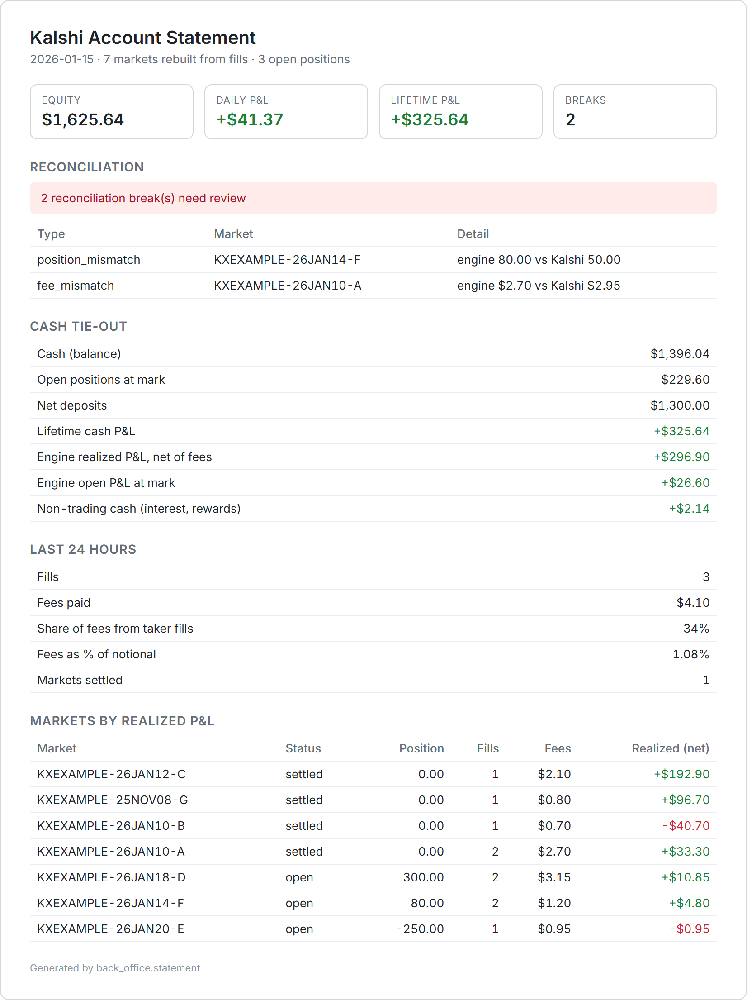

# kalshi-back-office

A daily back office for a [Kalshi](https://kalshi.com) event-contract account: it
rebuilds P&L from raw fills, reconciles that book against the exchange and
against cash, flags every break, and produces a daily statement.



*Statement from the bundled synthetic demo account. The two breaks are planted on purpose.*

## Why I built it

My day job is exchange-traded derivatives reconciliation at a bank: CME futures
and options, Canadian equity options, and cleared rate swaps. Every morning
starts with the same question: does our book agree with the clearing broker's,
and if not, why? When I started trading event contracts on Kalshi, I wanted the
same discipline on my own account. Kalshi tells you your balance and positions.
It doesn't tell you whether its numbers, your fills and your cash all agree.

This repo is the back-office layer of my personal trading system, extracted so
it runs on its own. It is read-only: it never places or cancels an order.

## What it does

```
Kalshi API (read-only)                                    output
  fills + historical fills ─┐
  settlements + archive ────┼─> P&L engine ─┐
  positions ────────────────┼───────────────┼─> reconciliation ─> breaks
  balance, deposits,        │               │                     daily statement (text + HTML)
  withdrawals ──────────────┘───────────────┘                     audit log (SQLite)
```

1. **Capture.** Pulls every fill and every settlement, including the ones
   Kalshi has moved out of its live endpoints into its historical archive, plus
   positions, balance and funding history. Every list endpoint is paginated.
   Reading only the first page is the classic way to quietly lose records.
2. **Rebuild the book.** Runs every fill through an average-cost engine, market
   by market, and closes residual positions at settlement.
3. **Reconcile three views.** The engine's book, the exchange's book, and cash.
   Every disagreement becomes a break with a type, a market and a size.
4. **Report.** A daily statement with equity, day-over-day P&L, lifetime P&L,
   the cash tie-out, 24-hour activity and fee drag, and the breaks to review.
   Every run is stored, so there's an audit trail of what the book looked like
   each day.

## How P&L is computed

Kalshi contracts pay $1 if the event happens and $0 if not. Every fill carries a
YES price and a NO price that sum to $1, and the exchange nets YES and NO
holdings in the same market. So the engine keeps one number per market: a
**YES-equivalent position**, where holding NO counts as being short YES.

- **Direction comes from the side.** A YES-side fill adds contracts and a
  NO-side fill subtracts them. The execution price in YES terms is always the
  fill's `yes_price`. This is less obvious than it sounds: closing a long YES
  position shows up in Kalshi's fill feed as a fill on the NO side. The
  convention was validated against Kalshi's own reported positions and realized
  P&L, market by market, on a live account.
- **Average cost.** Adding to a position re-weights the average entry price.
  Reducing it realizes (exit − average) per contract, signed by direction.
  Crossing through zero closes the old lot and opens a new one at the fill price.
- **Fees per fill.** Fees are tracked separately, so the statement can show
  gross and net, and fee drag, including how much of it came from taking
  liquidity.
- **Settlement at $1 / $0.** When a market settles, any residual position is
  closed at the payout and booked as settlement P&L.
- **Units by field name.** API records carry dollars (`yes_price_dollars`).
  Stored rows carry cents. The engine tells them apart by the field name, never
  by the size of the number. A "big number means cents" rule turns a 1-cent fill
  into a $1.00 fill.

## Reconciliation and break types

| Break | Meaning | Typical cause |
|---|---|---|
| `position_mismatch` | Engine position ≠ Kalshi position | A fill missing from the record, or a settlement not applied |
| `realized_mismatch` | Engine realized P&L ≠ Kalshi realized P&L | Wrong lot math, or a fill booked at the wrong price |
| `fee_mismatch` | Engine fees ≠ Kalshi fees paid | Fee adjustment or rebate the fill feed doesn't show |
| `missing_fills` | Kalshi shows an open position with no fills behind it | History gap |
| `unknown_side` | A fill has no readable side | API field change. Flagged rather than guessed, because a wrong sign inverts P&L |
| `cash_identity` | Cash is short of the engine, or ahead of it by more than interest could explain | A loss the fills don't show, or missing settlements |
| `cash_drift` | The non-trading cash residual jumped since the previous run | New cash the engine can't account for |

The per-market checks only cover markets the exchange still reports. Kalshi
drops old markets from its positions endpoint, and on my account that's about
700 of 4,800. The **cash identity** covers every market ever traded:

```
lifetime cash P&L = (cash + positions at mark) − (deposits − withdrawals)
                  = realized P&L net of fees + (positions at mark − their cost)
                    + non-trading cash
```

Non-trading cash is the interest Kalshi pays on balances plus any rewards.
Neither appears in a fill or a settlement, so on a real account the identity
never ties to zero. On mine it's $135.77 over 21 months, which matches
interest at Kalshi's rate on the account's average balance. Instead of
pretending it's zero, the reconciliation treats it as its own line, and checks
that it is:

- **never negative**, because interest can't remove cash;
- **no bigger than interest could plausibly be**, so an engine that is off by
  thousands can't hide in it;
- **steady between runs**, allowing up to one month's interest because Kalshi
  pays interest monthly.

Only applied deposits and withdrawals count, so a pending transfer never looks
like a gain or a loss. Daily P&L is computed the same way: the change in equity
minus the change in net deposits, against the stored run from about 24 hours
earlier. If a daily run was missed, the statement says how many hours the
number actually covers.

### Two lessons from running it on a live account

- **Settlements age out too.** Kalshi moves old fills to a historical endpoint,
  and old settlements as well: they only survive as records in its historical
  markets archive. Without that lookup, about 2,600 of my markets held to
  expiry never closed in the engine, and the cash identity was off by $99,291.
  Every per-market check still passed, because those markets were too old for
  the exchange to report.
- **The snapshot isn't instantaneous.** It takes a few seconds of API calls. A
  fill that lands between the positions call and the fills call makes them
  disagree for one run. Before a market break is reported, that market is
  fetched again on its own. A break that clears was a timing race, not a
  problem in the book.

## Try it without an account

```bash
pip install -r requirements.txt
python -m back_office demo
```

This runs the full pipeline on a bundled synthetic account (`back_office/fixtures/`,
generated by `tools/make_demo_fixture.py`). It has seven markets, four of them
held to settlement. One is old enough that its fills and settlement survive
only in Kalshi's historical archive, and the exchange no longer reports a
position for it. The account also has $2.14 of interest that no fill
mentions. The demo prints the statement and writes the HTML to `demo_output/`.
Two problems are planted in the data, and the reconciliation catches both: a
market where the exchange holds 30 fewer contracts than the fills add up to,
and a market where the exchange charged $0.25 more in fees than the fills show.

## Run it on a live account

Create an API key in Kalshi's account settings, then:

```bash
cp .env.example .env        # fill in KALSHI_API_KEY_ID and KALSHI_PRIVATE_KEY_PATH
python -m back_office statement     # reconcile + statement (text and HTML)
python -m back_office reconcile     # breaks only; exits 1 if there are any (cron-friendly)
python -m back_office capture       # append new fills, settlements and orders to the audit log
```

State lives in a local SQLite file (`--db`, default `back_office.db`).

## Tests

```bash
python -m pytest
```

50 tests, fully offline. They pin the P&L conventions, settlement (live and
archived), every break type, the non-trading cash rules, the re-check of
flagged markets, the missed-run label, and the API client (request signing,
pagination, merging live and historical fills, archive lookups, rate-limit
retry) against a fake HTTP session.

## Design notes

- **Pure core, thin edges.** `pnl.py` and `reconcile()` are pure functions over
  plain records. The API client and SQLite sit at the edges, which is why the
  demo, the tests and a live run all share one code path.
- **Breaks are data, not exceptions.** A break is recorded, sized, sorted
  largest first and stored with the run. Nothing is silently "corrected". The
  only break ever dropped is one that a fresh single-market fetch shows was a
  timing race, and the report counts those too.
- **Missing is not zero.** A settlement record without a usable value leaves
  the market open, and the cash identity then shows the gap. Defaulting it to
  $0 would quietly book a winning position as a loss.
- **Idempotent capture.** The audit log uses natural keys (fill id, order id,
  settlement time), so the capture job can run on any schedule or be re-run
  without double-booking.
- **Read-only by construction.** The client only issues GET requests.

## How this was built

I designed and directed this. The P&L conventions, the checks, and what counts
as a break come from my operations background and from reconciling my own
account. Most of the code was written with [Claude Code](https://claude.com/claude-code).

## Layout

```
back_office/
  client.py      read-only Kalshi client: RSA-PSS signing, pagination, endpoints
  fields.py      parsing for Kalshi's string-typed V3 fields
  pnl.py         average-cost P&L engine (pure)
  reconcile.py   engine vs exchange vs cash; break detection; run history
  statement.py   daily statement, text and HTML
  events.py      append-only audit log of fills, settlements and order lifecycle
  demo.py        offline demo on the bundled synthetic account
tests/           offline test suite
tools/           fixture generator for the demo account
```

Not affiliated with Kalshi.
